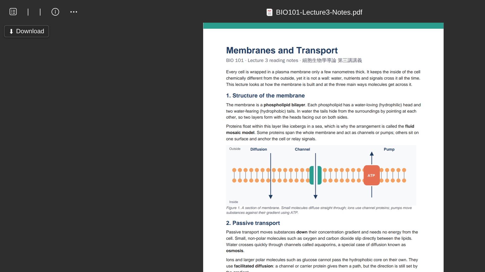
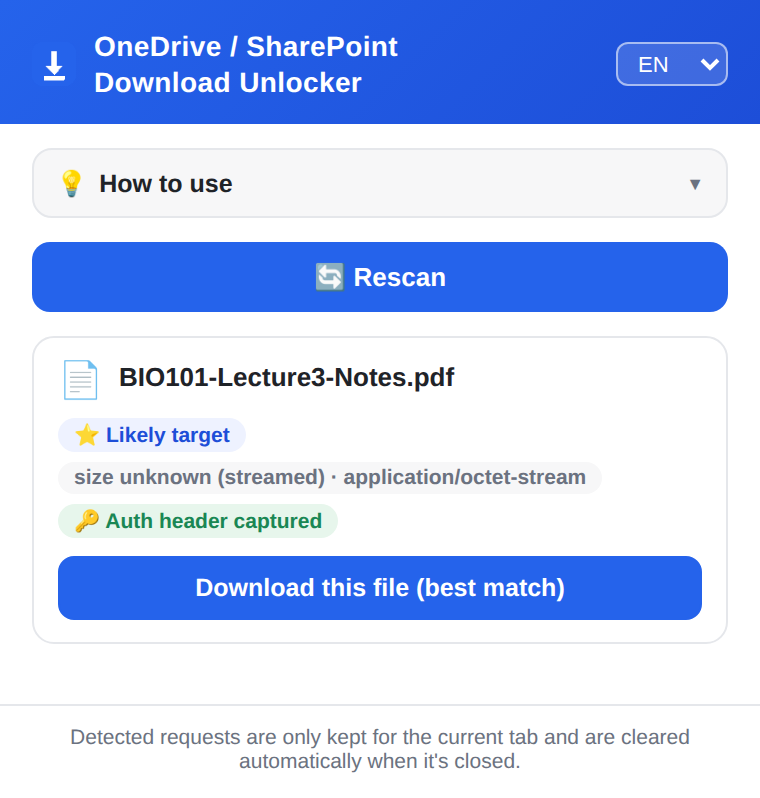

[English](./README.md) | **繁體中文**

# OneDrive / SharePoint 下載解鎖工具

最後更新：2026-10-21（版本 1.3.0）

一個瀏覽器擴充功能（Manifest V3），處理 OneDrive / SharePoint 上「只能看、不能下載」的檔案。它做兩件事：

1. **下載只能預覽的 PDF**：點一下就用原始檔名存到本機。
2. **匯出 PowerPoint 網頁版投影片**：把只能檢視（甚至套用敏感度標籤）的簡報存成圖片式 PDF，外加一份投影片文字的 `.txt`。

| | Chrome | Edge | Firefox |
|---|:-:|:-:|:-:|
| PDF 下載 | ✅ | ✅ | ✅ |
| 投影片匯出 | ✅ | ✅ | ✅（1.3.0 起） |

## 為什麼需要它

設成「只能預覽」的檔案沒有下載按鈕，但內容其實已經傳到瀏覽器。以前要在開發人員工具裡找出正確的請求、複製網址和驗證標頭再手動送出；這個擴充功能自動完成這些步驟，並在頁面上加一顆下載按鈕。

## 畫面截圖

| 預覽頁面上的下載按鈕 | 偵測到檔案的彈出視窗 |
| --- | --- |
|  |  |

## 安裝

目前沒有上架商店，請從 [Releases](../../releases) 頁面下載安裝。

### Chrome / Edge

1. 下載 `onedrive-download-unlocker-<版本>-chrome.zip` 並解壓縮。
2. 開啟 `chrome://extensions`（Edge 為 `edge://extensions`），打開右上角的「開發人員模式」。
3. 點「載入未封裝項目」，選擇解壓縮後的資料夾（裡面直接看得到 `manifest.json`）。

Chrome／Edge 會要求確認 `debugger` 權限（用於擷取投影片）。更新後若擴充功能被停用，按「啟用」即可。

### Firefox

1. 下載 `onedrive-download-unlocker-<版本>-firefox.zip` 並解壓縮。
2. 開啟 `about:debugging#/runtime/this-firefox`。
3. 點「載入臨時附加元件…」，選擇解壓後資料夾裡的 `manifest.json`。

臨時附加元件在 Firefox 重開後會消失，需要重新載入。

## 使用方式

### 下載 PDF

1. 開啟 OneDrive / SharePoint 的 PDF 預覽頁面。
2. 點頁面上出現的「下載 PDF」按鈕，檔案會存到「下載」資料夾。

沒看到按鈕的話，重新整理頁面，或打開彈出視窗按「重新掃描」。

### 匯出投影片

1. 在 PowerPoint 網頁版開啟簡報，等投影片顯示出來。
2. 點頁面右下角橘色的「匯出投影片（PDF）」按鈕；或點擴充功能圖示，選好畫質後按「匯出投影片（PDF）」。只要文字的話按「文字」。
3. 進度顯示在檢視器左下角。完成後，PDF 和 `.txt` 會在「下載」資料夾裡。

**畫質**（會記住上次的選擇）：標準 1600px（檔案小）、高 2000px、最高 2560px（接近可列印）。Chrome／Edge 的輸出以螢幕原生解析度為上限。

**Chrome／Edge**：匯出期間上方會出現「正在對這個瀏覽器進行偵錯」提示列，匯出結束後自動消失。關掉它會取消匯出。

**Firefox：**
- 匯出前先在 PowerPoint 頁面點一下工具列上的擴充功能圖示。
- 匯出期間讓分頁保持在最前面。
- 需要 Firefox 140 以上。

**其他說明：**
- 按匯出按鈕上的 **✕** 可在這個頁面隱藏它。
- 匯出中途停止時，已完成的部分照樣會存下來（例如 `…(1-12 of 50).pdf`）。
- 「您沒有編輯此檔案的權限」通知和「按一下以新增…」提示字會自動排除，不會出現在截圖裡。
- Arc 瀏覽器每擷取一張，視窗會閃一下。
- 強制開啟右鍵／複製的擴充功能（例如 *Absolute Enable Right Click & Copy*）會讓匯出變得很慢，匯出時請先停用。

## 運作原理

- **PDF 下載**：`background.js` 監看微軟網域上的網路請求（`webRequest`），用網址關鍵字（`passthrough`、`download.aspx`、`getfilebycontent`、`allowlistfiletype` 等）找出帶有檔案內容的請求，下載時帶著擷取到的標頭重新送出。超過 8 MB 的檔案分成每塊 8 MB 傳到頁面，所以不受瀏覽器訊息大小上限影響。
- **投影片匯出**：`slides.js` 在 PowerPoint 檢視器裡執行，用方向鍵逐張切換，等每張投影片（含字型和圖片）完全渲染後擷取，最後在本機組成 PDF。Chrome／Edge 透過 debugger API（`Page.captureScreenshot`）擷取，Firefox 用 `tabs.captureVisibleTab`。

## 自行打包

```powershell
powershell -ExecutionPolicy Bypass -File build.ps1   # macOS／Linux：pwsh build.ps1
```

會在 `dist/` 產出 `onedrive-download-unlocker-<版本>-chrome.zip` 和 `-firefox.zip`，版本號取自 `manifest.json`。Firefox 版的 manifest 由 `manifest.json` 自動產生，只需要維護一份。

## 檔案結構

- `manifest.json`：擴充功能設定（Firefox 版由 `build.ps1` 自動產生）
- `build.ps1`：打包腳本
- `background.js`：偵測請求、下載，以及投影片匯出中需要權限的部分
- `content.js`：頁面上的下載按鈕與「匯出投影片」按鈕
- `popup.html`／`popup.js`：彈出視窗（檔案清單、語言、投影片匯出與畫質）
- `slides.js`：投影片匯出（翻頁、等待渲染、擷取、輸出、狀態列）
- `slides-viewer.js`：所有依賴 PowerPoint 網頁版頁面結構的部分；微軟改版時要修的就是這個檔
- `slidepdf.js`：組成圖片式 PDF
- `util.js`：共用工具（檔名、分塊傳輸、存檔）
- `i18n.js`：中英文字串
- `PRIVACY.md`、`CHANGELOG.md`、`LICENSE`

## 測試

- **投影片匯出**：在 macOS + Arc 上經多輪實測調校。1.2.1 起每個版本都用真實的 50 張 SharePoint 簡報（含圖片、表格、圖表、中日文）完整匯出並逐張檢查。1.3.0：Chromium 50/50 張，約 41 秒；Firefox 157 50/50 張，約 48 秒。另有對模擬檢視器的自動化測試，涵蓋頁內按鈕、取消、部分保存（25/25）。
- **大型檔案（issue #1）**：對需要 `X-SPOPacToken` 的模擬 SharePoint 伺服器測試 8 MB、70 MB、150 MB、400 MB，下載結果與原檔逐位元組相同。
- **Firefox PDF 下載（issue #2）**：由提出需求的使用者確認可用。

遇到問題請開 Issue，附上瀏覽器、操作步驟和發生的狀況。

## 已知限制

- 只支援微軟全球商用雲（`*.sharepoint.com` 等），不含主權雲（`.sharepoint.us`／`.cn`／`.de`）。
- PDF 偵測靠網址關鍵字。微軟改了這些網址的話，需要更新 `background.js` 裡的 `URL_KEYWORDS`。
- 投影片匯出是圖片式 PDF，文字另存在 `.txt`。下一步規劃：PDF 內可選取的文字層，以及超過螢幕解析度的輸出。

## 授權

[MIT](./LICENSE)
